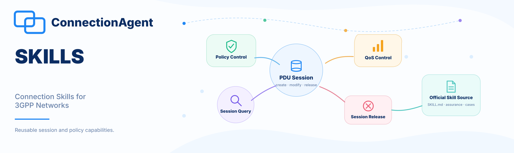

# ConnectionAgent Skills

Official Skill source and Skill-language contract for ConnectionAgent.

## Authority

**This repository is the only authoritative input for official Skill source and language semantics.** `ca-agent-demo` is used as a current behavior/implementation reference when refreshing examples; Compiler and Studio consume the official source from this repository.

## v1alpha4 PDU Session authoring examples

The two PDU Session examples are under **[`examples/skills/`](examples/README.md)**, using v1alpha4 Contract / Procedure / PredicateSet source form:

| Example | Intent | Qualification |
|---|---|---|
| `examples/skills/establish-pdu-session` | Conventional UE-requested initial establishment | Author-source shape only; Owner linking NOT_QUALIFIED |
| `examples/skills/establish-pdu-session-mas` | MAS policy-first establishment | Author-source shape only; MAS Owner contract NOT_QUALIFIED |

Their complete original v1alpha1/v0.2 sources, all Cases and five conventional scripts are preserved in `examples/legacy/` for **behavior comparison, not v1alpha4 compilation**. The legacy 12-Operation `lib/tools/createdsession.tool.yaml` remains an unqualified old snapshot; never relabel it as an approved v1alpha4 ToolCatalog.

**The frozen language is not the same as a linked runnable Skill.** The v1alpha4 examples use marked `urn:example` references to describe expected external Owners and Evidence. Real exact v1alpha4 Owner/Capability snapshots are still required, and correct Compiler behavior without them is fail-closed.

## Language and authoring

- [Current CA-SL v1alpha4 language specification](docs/skill-language-spec.md)
- [Script Contract v0](docs/script-contract.md)
- [Schema Ownership](docs/schema-ownership.md)
- [Authoring Model](docs/authoring-model.md)
- [Skill package layout](docs/project-layout.md)
- [Current 5GC source baseline](docs/current-5gc-skill-baseline.md)
- [Semantic token registry](language/semantic-tokens.v1.json)
- English: [Authoring Guide](docs/authoring.md)
- 中文：[Skill 编写指南](docs/authoring.zh-CN.md)

## Compiler boundary

The Compiler receives caller-supplied source and imported contract bytes, parses and links the Skill language, performs static validation, generates Script Output Schemas and returns a deterministic file map.

It does **not** acquire or manage dependencies, connect to Git/Upload/MCP, maintain locks/caches, run Python, execute Tools, run Qualification or claim Runtime readiness. Studio/caller assembles `files` and targets and decides how to display/export BuildResult files.

Current transition:
- [ca-skill-compiler PR #3](https://github.com/odango-chan/ca-skill-compiler/pull/3): v0 closeout ready for review; full v0 implementation remains PARTIAL.
- [ca-skill-compiler PR #4](https://github.com/odango-chan/ca-skill-compiler/pull/4): narrowed Compiler-only v0.1 design; design only.

`make verify` runs legacy source hygiene and the frozen v1alpha4 documentation structure lint with negative regression tests; it does **not** invoke the old Toolchain or claim Compiler/Runtime/Owner acceptance.

Other historical packages under `skills/` remain untouched and are outside the current 5GC syntax baseline.
