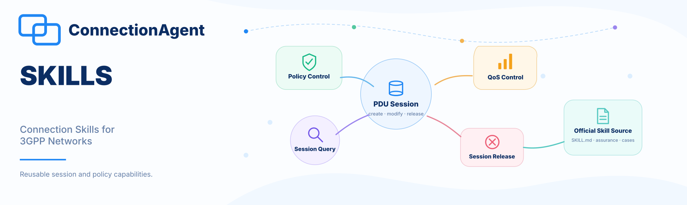

# ConnectionAgent Skills

ConnectionAgent 官方 Skill 源码与语言契约仓库。

## 权威边界

**本仓库是官方 Skill 源码和语言语义的唯一输入权威。** `ca-agent-demo` 用于核对当前实际运行行为、刷新样例；Compiler 和 Studio 应消费本仓库的正式源码。

## CA-SL v1alpha5 示例

[PDU 会话建立示例](examples/README.md)包含传统 5GC 和 OpenAMSM MAS 两套流程，均以[已冻结的 CA-SL v1alpha5](docs/releases/ca-sl-v1alpha5.md)为准。示例仍待可信 Owner 契约与集成验收，状态为 `NOT_QUALIFIED`。

## 历史 5GC 源码（v0.2/v1alpha1）

`skills/` 下的两套 5GC 源码及对应 ToolCatalog 保留为旧业务基线。

| Skill | 业务范围 | 源码状态 |
| --- | --- | --- |
| `establish-pdu-session` | 传统 UE 请求的初始 PDU Session Establishment | 五个 Script 已迁移到严格 Output TypedDict |
| `establish-pdu-session-mas` | MAS policy-first 建立流程候选 | 保留；16 个 Operation 引用仍未解析 |

传统 Skill 使用正式批准的 `lib/tools/createdsession.tool.yaml` 快照（12 个 Operation）。MAS 设计稿 ToolCatalog 尚未获批，不能作为正式导入契约。

本次保留了当前 5GC 业务流程和标量 Operation `call` 身份。传统 Skill 的五个 Python Script 已采用[新 Script 契约](docs/script-contract.md)。旧的 Script 输入/输出重复 Schema 已移除；Script 输出 Schema 由目标 Compiler 自动生成。

## 语言与编写规范

- [当前 CA-SL v1alpha5 语言规范](docs/skill-language-spec.md)
- [历史 CA-SL v1alpha4 语言规范](docs/skill-language-spec.v1alpha4.zh-CN.md)
- [Script 契约 v0](docs/script-contract.md)
- [Schema 所有权](docs/schema-ownership.md)
- [Authoring Model](docs/authoring-model.md)
- [Skill 包目录规范](docs/project-layout.md)
- [当前 5GC 源码基线](docs/current-5gc-skill-baseline.md)
- [语义 Token 注册表](language/semantic-tokens.v1.json)
- English: [Authoring Guide](docs/authoring.md)
- 中文：[Skill 编写指南](docs/authoring.zh-CN.md)

## Compiler 边界

Compiler 接收调用方提供的源码和外部契约字节，解析/链接 Skill 语言，进行静态校验，生成 Script Output Schema，并返回确定性的文件集合。

Compiler **不**负责获取或管理依赖、不连接 Git/Upload/MCP、不维护 Lock/Cache、不运行 Python、不执行 Tool、不运行 Qualification，也不宣称 Runtime READY。Studio/调用方负责组装 `files` 和 targets，并决定如何展示/导出 BuildResult。

当前迁移状态：
- [ca-skill-compiler PR #3](https://github.com/odango-chan/ca-skill-compiler/pull/3)：v0 Closeout 已准备 Review；完整 v0 实现仍为 PARTIAL。
- [ca-skill-compiler PR #4](https://github.com/odango-chan/ca-skill-compiler/pull/4)：已收敛为仅 Compiler 的 v0.1 设计，尚未实施。

`make verify` 检查源码、v1alpha4 继承基线、v1alpha5 规范和诊断索引，以及 Wait 和 Ingress 登记表。Compiler、Runtime 和 Owner 另行验收。

`skills/` 下其他历史 Skill 保持原样，不属于当前 5GC 语法基线。
