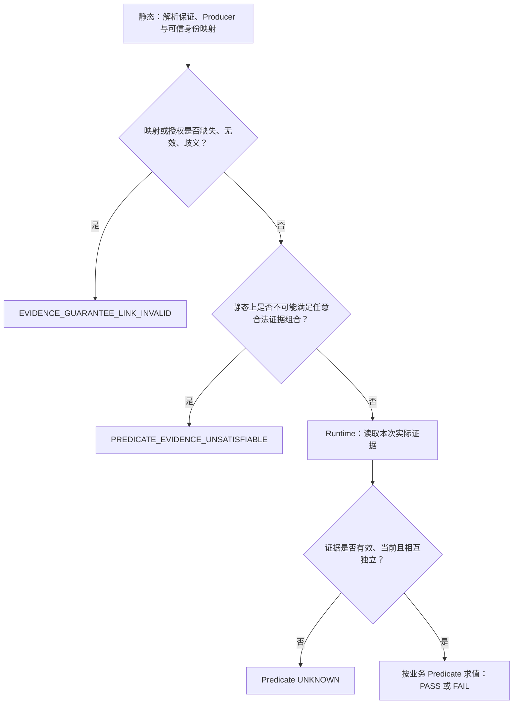

# CA-SL v1alpha3 — 执行决策与条款追溯索引

**性质：** 资料性索引（Informative）  
**语言目标：** `connectionagent.io/v1alpha3`  
**权威依据：** [CA-SL 完整规范](../skill-language-spec.zh-CN.md)  
**产品符合性：** NOT QUALIFIED

本索引只整理已经冻结的执行判定和条款关系。出现不一致时，**以对应规范性条款为准**，不得以本表重新定义 Owner Outcome、Stage Outcome 或 Invocation 终态。

## 1. Mutation/Reconcile 决策索引

| 处理阶段 | 已验证事实或条件 | 阶段路由 / 执行后果 | 规范性来源 |
|---|---|---|---|
| Mutation | 原调用提交证明有效，SUCCEEDED 所承诺输出和保证均有效 | 记录已提交；沿 **Mutation Stage** 的 SUCCEEDED 边，非 Invocation 成功终态 | §20.1、§12.8–§12.9 |
| Mutation | 已提交，但承诺输出缺失、不合法或无法关联 | 保留提交状态与责任；`COMMITTED_OUTPUT_UNAVAILABLE`；按 §12.8 停止，存在待处置的确认变更则 SAFE_STOPPED | §20.1、§20.1.1 |
| Mutation | 已证明未提交，Owner 结果属于已声明、已验证的确定失败类别且无残留副作用 | 根据 Owner 已声明映射沿 FAILED 或 NOT_COMMITTED；FAILED 不自动准许重试 | §20.1、§20.2 |
| Mutation | 无可信提交结论，或可信证明相互矛盾 | OUTCOME_UNKNOWN；根据已链接的调和契约进入唯一 Reconcile 或安全停止，保留原调用责任 | §20.1、§20.2 |
| Reconcile 准入 | 与原 Mutation 绑定的独立 READ callable、Capability、Scope、Deadline、预算及原 Invocation 证明有效 | 对同一原调用至多执行一次 READ 调和；不得新增业务 Mutation | §12.7、§20.2、G.2 |
| Reconcile | Owner SUCCEEDED 且证明原调用已提交；恢复子对象有效或契约不承诺恢复数据 | Reconcile Stage COMMITTED；只有已验证的 `recoverableOutputPath` 子对象可绑定为 `operation.output` | §20.3、G.2 |
| Reconcile | 已提交，但承诺的恢复子对象缺失或校验失败 | `COMMITTED_OUTPUT_UNAVAILABLE`；保留已确认提交及责任，按 §12.8 停止 | §20.3、G.2 |
| Reconcile | Owner SUCCEEDED 且可信证明原调用未提交 | Reconcile Stage NOT_COMMITTED；重试仍需独立证明与一次性授权 | §20.3、§20.2 |
| Reconcile | 未取得有效且不冲突的提交结论 | Reconcile Stage UNRESOLVED，按 §12.8 判定终态并保留原调用责任 | §20.3、§20.1.1 |
| 任一停止路径 | 存在已确认 PENDING 责任 | SAFE_STOPPED 优先；否则有未决提交/关键事实时为 UNRESOLVED；其他情形按 §12.8 | §12.8、§20.1.1、G.5 |
| 任一成功请求 | 到达 SUCCEEDED 路由 | 只有全局门禁、最新 Goal PASS、Scope/Evidence 与责任全部通过复核，才可发布 Invocation SUCCEEDED | §12.8–§12.9、G.8 |

**分类说明：** `COMMITTED`、`NOT_COMMITTED`、`UNRESOLVED` 在 Reconcile 表示 Stage Outcome；`OUTCOME_UNKNOWN` 是 Mutation Stage Outcome；`SUCCEEDED` 作为右侧路由目标才可能表示请求发布 Invocation 终态。Owner callable 的 `ownerOutcomes` 不得包含 Runtime 自行产生的分类。以上索引不替代 §20.1、§20.3、G.2.2 的证明结构和路径校验。

## 2. Evidence 独立性判定流程（资料性）

该流程不为不同 Owner 名称自动推导独立性，也不为 Runtime 添加新的证据来源。可信跨域关系和共同事实映射来源见 §34.0.2、F.4、G.3.1。

## 3. 条款与诊断/用例导航

| 规范条款 | 判定边界 | 典型诊断或 Outcome | 现有用例与未验收项 |
|---|---|---|---|
| §10、G.1 | 作者语法、标识符、路径与版本目标 | IDENTIFIER_INVALID / QUALIFIED_REFERENCE_INVALID / PACKAGE_PATH_INVALID | E105、E114；未覆盖项见 DFX |
| §11.5、G.6 | Host Context 与 Request 双 Schema | REQUEST_SCHEMA_MISSING / CONTEXT_REQUEST_COLLISION | E113 |
| §12.7–§12.9、§22.1 | DAG、路由、全局门禁及 Goal | ROUTE_OUTCOME_MISSING / ENTRY_PRECONDITION_BYPASSED | E24、E51、E55、E84；部分路由诊断仍待 Fixture |
| §13.3、§23、§30 | 身份实参来源、UE/Lifecycle/PSI Scope | CALLABLE_ARGUMENT_PROVENANCE_INVALID | E101；真实 5GC Owner 发布/运行未验收 |
| §17.1–§17.2、G.3.1 | 保证链接、独立性与证据时效 | EVIDENCE_GUARANTEE_LINK_INVALID / PREDICATE_EVIDENCE_UNSATISFIABLE / Predicate UNKNOWN | E102、E106；Runtime 具体分支待执行 |
| §20、G.2.2、G.5 | Mutation/调和、证明与责任 | OUTCOME_UNKNOWN / COMMITTED / NOT_COMMITTED / SAFE_STOPPED | E107–E109、E112；不得将预期视为实测 |
| §32、F.6、G.4 | Script/CEL 输入和类型检查 | SCRIPT_CONTRACT_INVALID / CEL_INVALID / SCHEMA_INVALID | E67、E110、E111；版本互操作待 §45.2 验收 |
| §34.0–§34.0.2、F.4 | 快照、Owner 归属与可信部署绑定 | DEPENDENCY_IDENTITY_UNVERIFIED / EVIDENCE_GUARANTEE_LINK_INVALID | E04、E102、E103 |
| §45.2 | 实现符合性与发布 | 八项独立验收门槛 | 目前 NOT QUALIFIED |

**机器可读追溯：** [E01–E114 预期索引](../fixtures/ca-sl-v1alpha3-case-traceability.yaml)；[诊断覆盖缺口](../fixtures/ca-sl-v1alpha3-diagnostic-fixture-gaps.yaml)。现有记录包含 `ciFixture: null` 或 `ciResult: NOT_RUN`，不表示任何实际产品通过测试。
